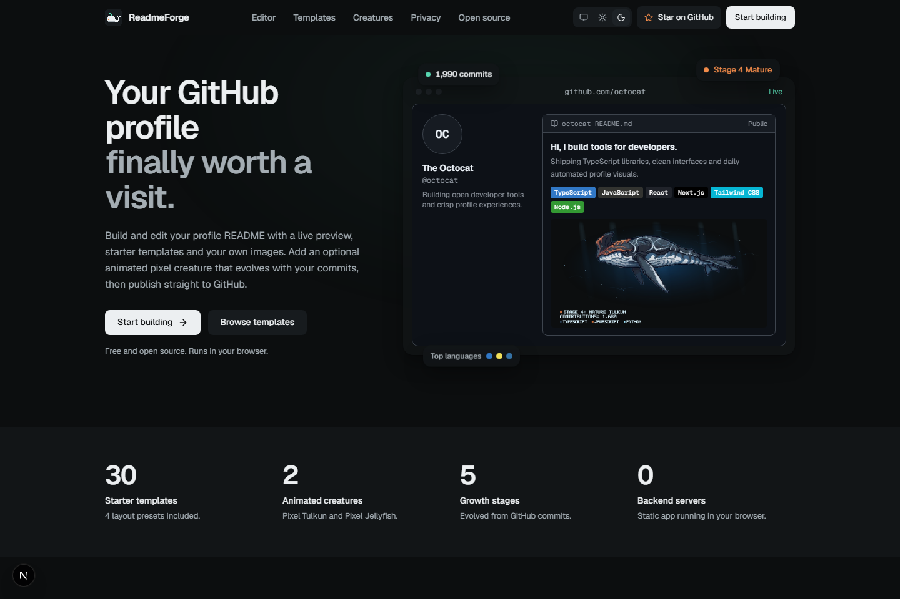
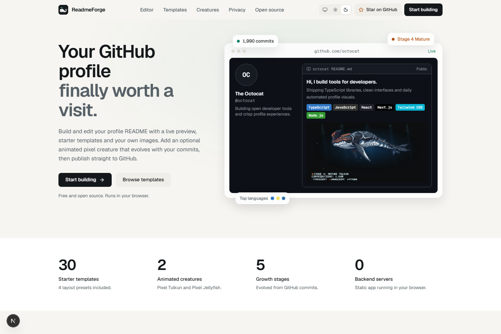
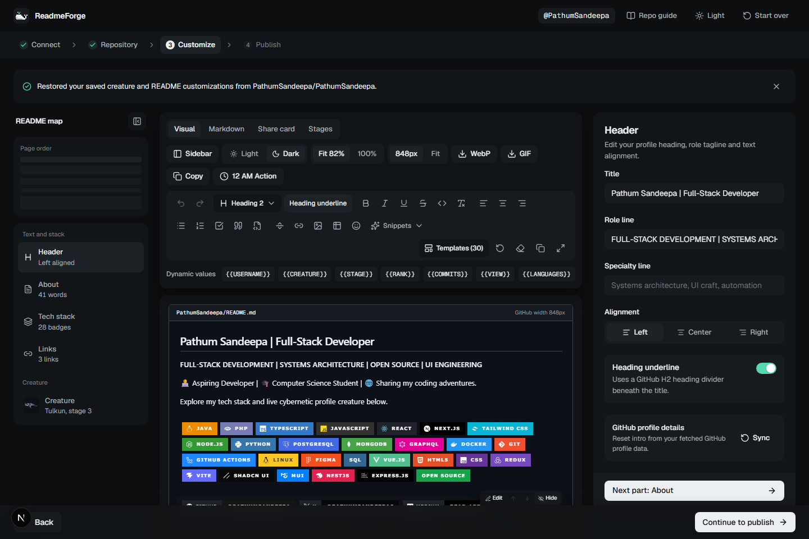
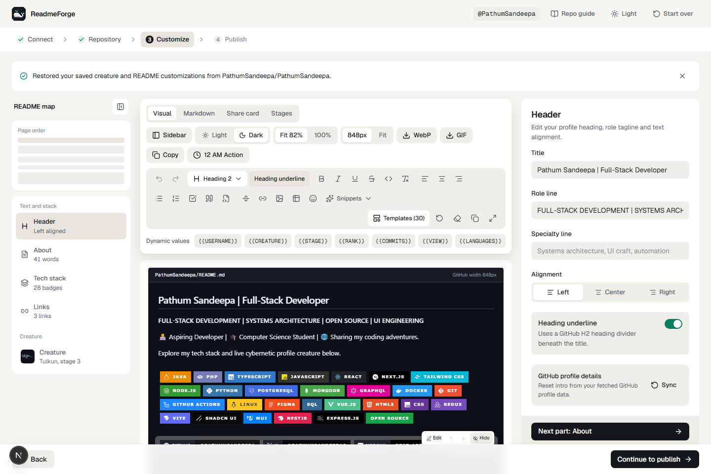
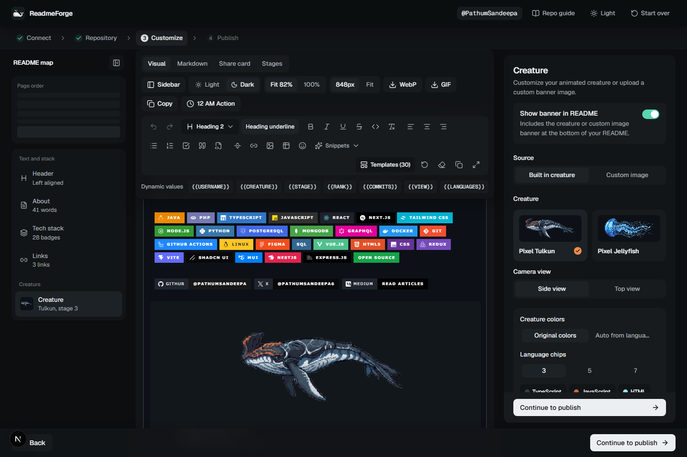
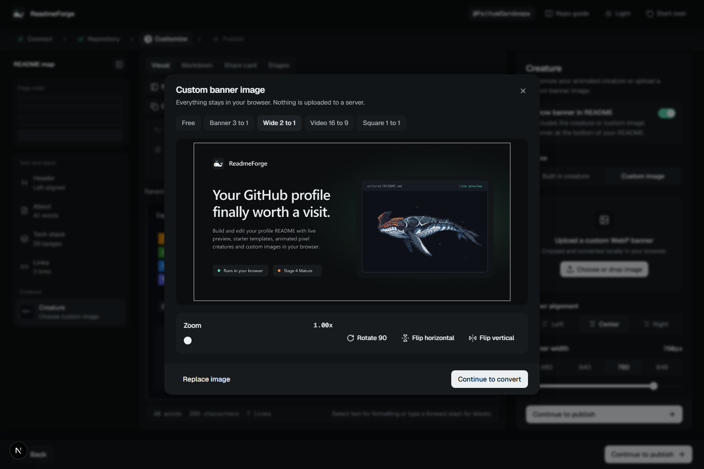
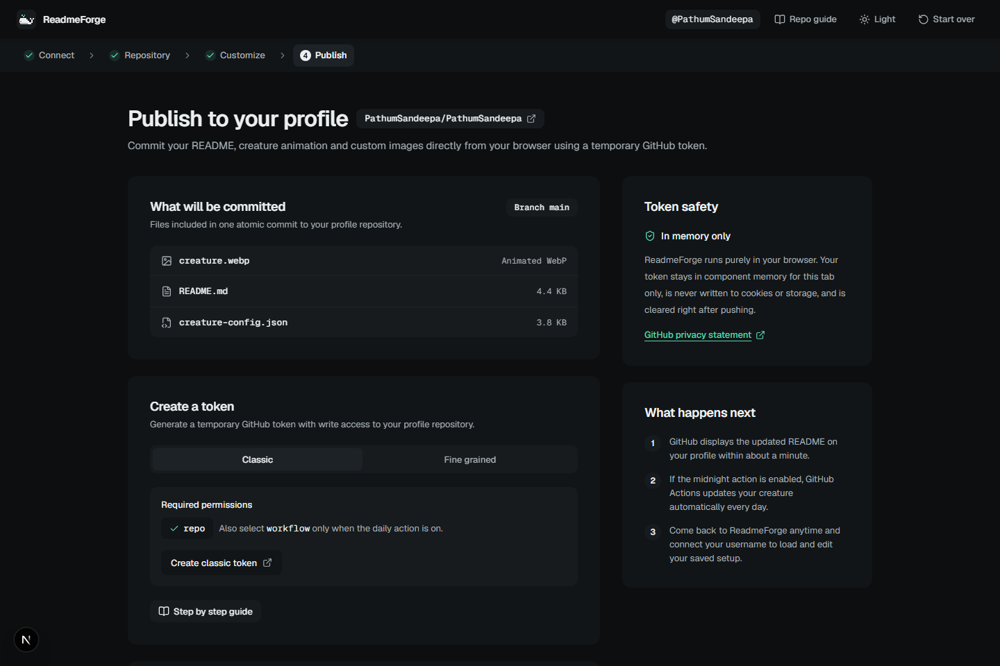
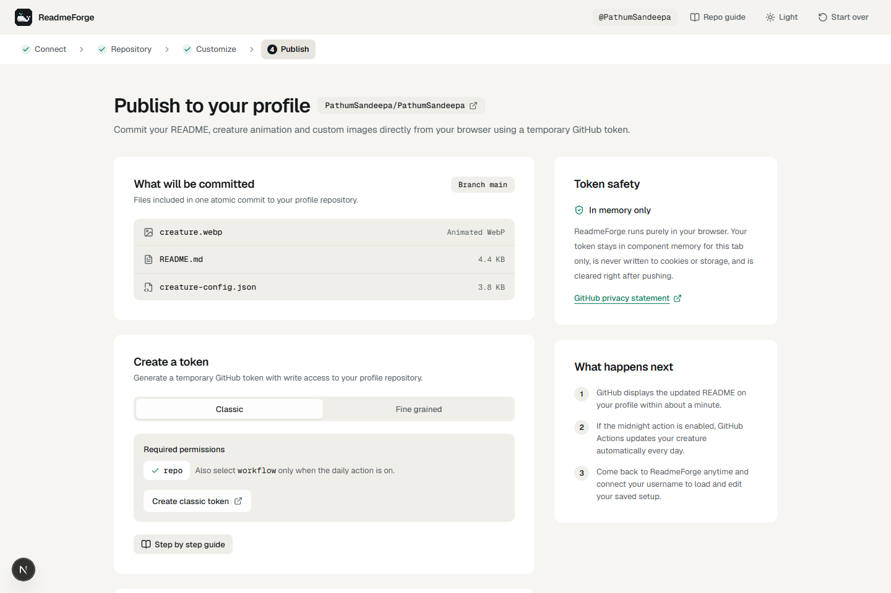

# ReadmeForge

Build a GitHub profile README that moves.

Build, edit and publish a GitHub profile README in your browser with live preview, starter templates, animated pixel creatures and custom images.



> This is an open source project. Issues, ideas and pull requests are welcome.

## Links

- Live site: [pathumsandeepa.github.io/dynamic-readme-creature](https://pathumsandeepa.github.io/dynamic-readme-creature/)
- Repository: [github.com/PathumSandeepa/dynamic-readme-creature](https://github.com/PathumSandeepa/dynamic-readme-creature)
- Issues: [github.com/PathumSandeepa/dynamic-readme-creature/issues](https://github.com/PathumSandeepa/dynamic-readme-creature/issues)

## Screenshots

### Home page in dark and light themes




### Customize workspace with README map





### Creature inspector



### Custom image crop studio



### Publish workflow in dark and light themes





## Features

- **README map and inline editing**: Navigate sections from the outline (`Header`, `About`, `Tech stack`, `Links`, `Creature`) and edit directly at the real `848px` GitHub README width with TipTap, slash commands, dynamic value tokens and a raw Markdown view.
- **30 starter templates**: Search by keyword or filter by category, preview at GitHub width, and confirm whether to replace your intro or insert below.
- **202 plus tech badges**: Browse `202` built in badges across `11` categories or add custom badges, organize them into reorderable stack groups and manage visibility on the canvas.
- **Link buttons**: Add profile action buttons for websites, social links and developer profiles with automatic platform icon matching.
- **Animated pixel creatures with five growth stages**: Customize `Pixel Tulkun` and `Pixel Jellyfish`, pick side or top views, map language colors onto creature regions and scale through `5` stages from your commit count.
- **Custom images with crop and WebP conversion**: Crop, zoom, rotate in 90 degree steps and flip images in your browser with `react-easy-crop`, encode WebP locally and save assets under `readme-assets`.
- **WebP and GIF export**: Export `creature.webp`, `creature.gif`, Markdown files or a complete bundle zip directly in your browser.
- **Share card**: Preview and include a `1280` by `640` `share-card.png` summary graphic.
- **Midnight auto evolve GitHub Action**: Generate `.github/workflows/evolve-creature.yml`, `scripts/evolve-creature.mjs` and `creature-config.json` to keep `creature.webp` and `README.md` up to date daily.
- **Dark and light themes**: Switch seamlessly between `Abyss` dark and `Paper` light studio themes while independently previewing GitHub Light or GitHub Dark README surfaces.

## How it works

1. **Connect**: Enter a GitHub username or profile URL for a live read only preview of public language weights, commit counts and any saved setup in your profile repository.
2. **Repository**: Follow the three step guide to confirm or create your public username profile repository on GitHub.
3. **Customize**: Edit every section in place with the README map, rich text tools, templates, tech stack cards, link buttons and animated creature or custom WebP studio.
4. **Publish**: Paste a temporary Classic or Fine grained Personal Access Token to push your files in one atomic commit, or download every asset manually.

## Privacy and security

- **Browser only**: All rendering, image cropping, WebP encoding, GIF encoding and GitHub requests run directly inside your browser tab.
- **Token in memory only**: Personal Access Tokens stay strictly in React component state for the active tab, never touch cookies or web storage and are cleared immediately after pushing.
- **No server**: The app is exported statically (`output: "export"`) with zero backend databases, proxies or analytics trackers.

## Tech stack

- Next.js `16.4.6` (App Router with static export)
- React `19.3.0` and TypeScript `5`
- Tailwind CSS `4.3.3`, shadcn with `@base-ui/react` and `lucide-react`
- TipTap `3.35.0` (`@tiptap/react`, starter kit, table, task list, image and align extensions)
- `react-easy-crop`, `react-color-palette`, `gifenc`, `simple-icons`, `sharp` and `playwright`

## Getting started

Install Node.js `22` or newer and `pnpm` (`12.21.0`).

```bash
git clone https://github.com/PathumSandeepa/dynamic-readme-creature.git
cd dynamic-readme-creature
pnpm install
pnpm dev
```

Open `http://localhost:3000` in your browser.

Useful scripts:

```bash
pnpm dev
pnpm build
pnpm lint
pnpm exec tsc --noEmit
```

## Project structure

```text
src/
  app/            Next.js App Router entry, fonts and global CSS
  application/    Studio state controller hook
  components/ui/  Shared base UI primitives
  config/         Brand metadata and site URLs
  domain/         Creature animation, evolution, profiles, templates and workflow generation
  infrastructure/ Browser encoders, downloads, crop engine, zip builder and GitHub client
  presentation/   Studio layout, design tokens, home page and four step screens
docs/
  screenshots/    Curated dark and light PNG screenshots
public/
  showcase/       Static creature artwork and hero preview assets
```

## Contributing

Contributions, bug fixes and template ideas are welcome.

1. Open an issue at [github.com/PathumSandeepa/dynamic-readme-creature/issues](https://github.com/PathumSandeepa/dynamic-readme-creature/issues) to discuss bugs or feature ideas.
2. Fork the repository, create a branch and make focused changes without breaking existing flows.
3. Follow the project notes in `AGENTS.md`: check Next.js `16` framework guides under `node_modules/next/dist/docs` when changing framework integrations, keep copy free of em dashes, semicolons and emoji and avoid workspace workarounds.
4. Run `pnpm exec tsc --noEmit`, `pnpm lint` and `pnpm build` before opening a pull request.

## License

Released under the MIT License. Copyright (c) 2026 PathumSandeepa. See [LICENSE](./LICENSE).

## Credits

Made by Pathum Sandeepa.
