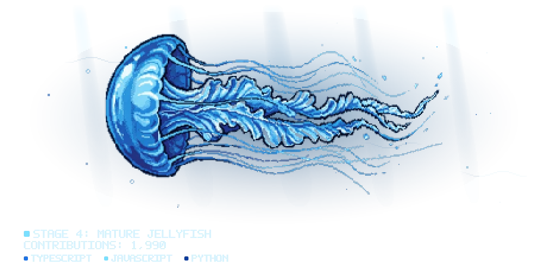
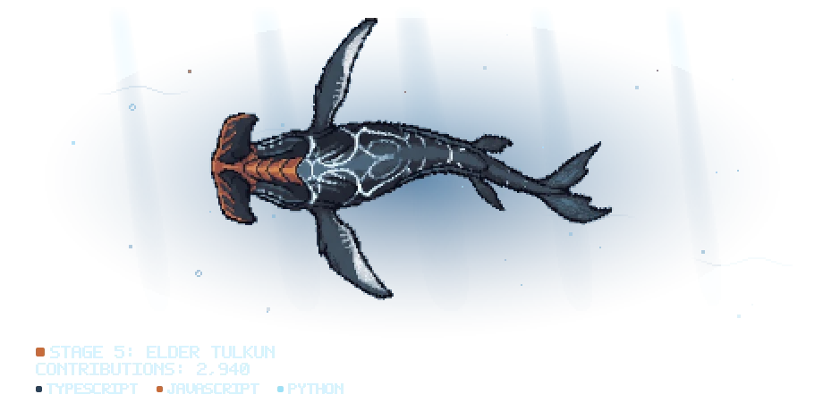
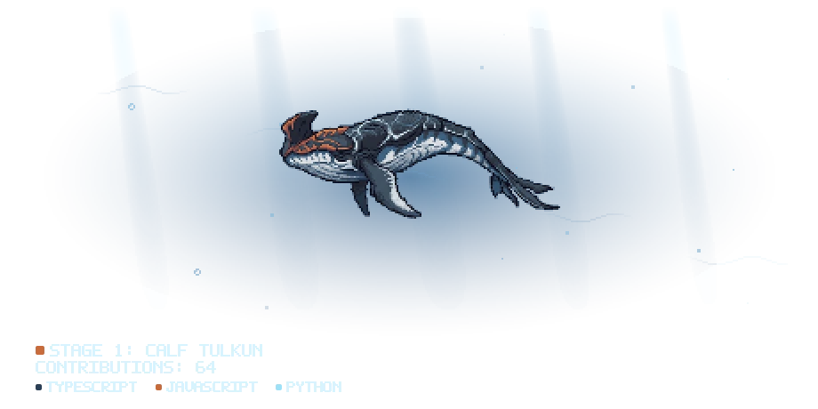
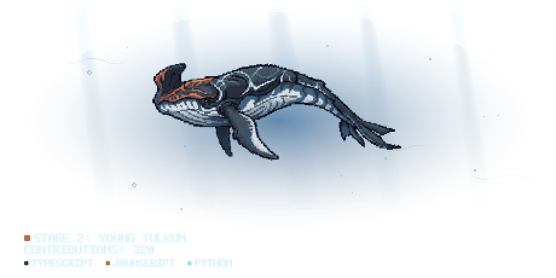
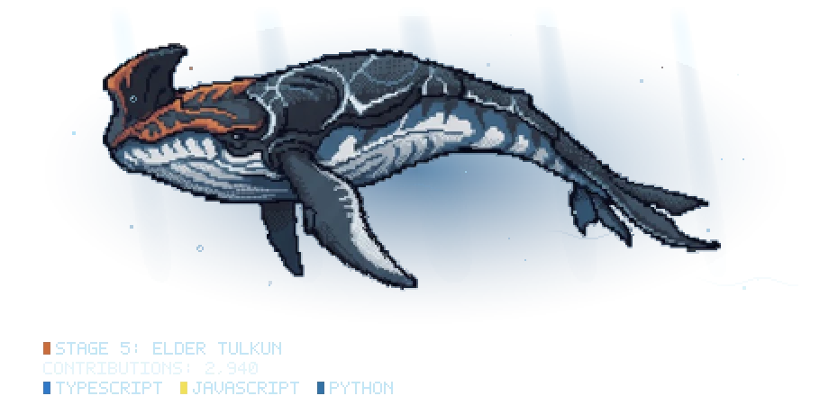
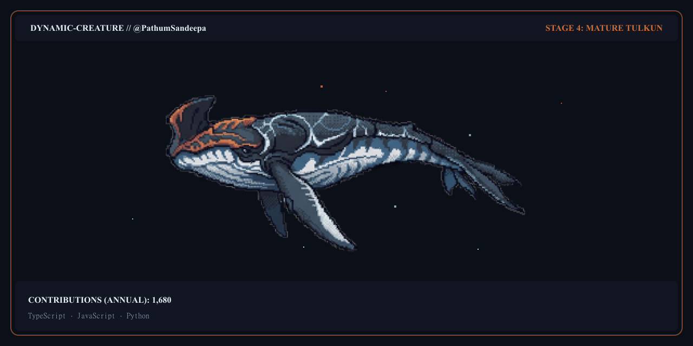

# dynamic-readme-creature

A sprite-based, S-curve animated marine creature generator for your GitHub profile `README.md` that evolves across **5 growth stages (`0 → 2,500+` contributions)**, exports true **Animated WebP** and **Animated GIF** assets (with transparent or custom-colored backgrounds), syncs with your **top GitHub programming languages**, and updates automatically at **12:00 AM** via GitHub Actions.

<p align="center">
  <a href="https://pathumsandeepa.github.io/dynamic-readme-creature/">
    
  </a>
</p>

<p align="center">
  <em>Live <code>dynamic-readme-creature</code> generated from <a href="https://github.com/PathumSandeepa">@PathumSandeepa</a>'s GitHub activity (Stage 4: Mature Pixel Tulkun)</em>
</p>

---

## Quick Start (2-Step Setup)

1. Open the **[Interactive Creature Studio](https://pathumsandeepa.github.io/dynamic-readme-creature/)**, sync your GitHub username, customize your animated creature & Profile `README.md`, and either click **Push Changes to README** (with a fine-grained PAT held strictly in ephemeral browser memory with copy/cut disabled, under the [GitHub Privacy Statement](https://docs.github.com/en/site-policy/privacy-policies/github-general-privacy-statement)) or embed this block in your profile repo (`YOUR_USERNAME/YOUR_USERNAME`):

```html
<!-- CYBER-CREATURE:START -->
<p align="center">
  <a href="https://github.com/YOUR_USERNAME/YOUR_USERNAME">
    
  </a>
</p>
<!-- CYBER-CREATURE:END -->
```

> If your `README.md` includes `<!-- CYBER-CREATURE:START -->` and `<!-- CYBER-CREATURE:END -->`, the 12:00 AM auto-evolve script automatically regenerates `creature.webp` and updates your live stage, commit count, top languages, and telemetry table every day at midnight.

2. Include `.github/workflows/evolve-creature.yml`, `scripts/evolve-creature.mjs`, `creature-config.json`, and `assets/creature-sprite.png` (available via the **Include 12:00 AM Daily Auto-Evolve GitHub Action** checkbox or the **12:00 AM Action** modal):

```yaml
name: Evolve Cyber Creature & Profile Details

on:
  schedule:
    - cron: "0 0 * * *"
  workflow_dispatch:

permissions:
  contents: write

jobs:
  evolve:
    runs-on: ubuntu-latest
    steps:
      - uses: actions/checkout@v4
      - uses: actions/setup-node@v4
        with:
          node-version: "22"
      - run: npm install --no-save --prefix /tmp/creature-deps sharp
      - name: Fetch Live Telemetry & Regenerate Animated creature.webp
        env:
          GITHUB_TOKEN: ${{ secrets.GITHUB_TOKEN }}
          PROFILE_PAT: ${{ secrets.PROFILE_PAT }} # optional for private contributions
          GITHUB_USERNAME: ${{ github.repository_owner }}
        run: NODE_PATH=/tmp/creature-deps/node_modules node scripts/evolve-creature.mjs
```

---

## 2 Selectable Pixel Creatures

| Creature | View Angles | Live Animated Preview | Motion & Kinematics |
| --- | :---: | :---: | --- |
| **Pixel Tulkun**<br/>*Armored Leviathan* | `Side View` &amp; `Top View` |  | Smooth per-pixel S-curve body swimming, pectoral fin sweeps, and forked tail propulsion in both lateral side view and dorsal top view. |
| **Pixel Jellyfish**<br/>*Bioluminescent Medusa* | Pelagic View |  | Rhythmic anatomical bell contraction, forward jet-propulsion surge, and fluid S-curve undulating oral arms and trailing filaments. |

---

## Tulkun Camera Perspectives (`side` & `top`)

| Perspective | Live Animated Preview | Description |
| --- | :---: | --- |
| `view: side`<br/>*(Default)* |  | **Side View:** Lateral S-curve swimming with copper brow crest, pleated jaw, pectoral fin strokes, and vertical tail propulsion. |
| `view: top` |  | **Top View:** Dorsal S-curve swimming showcasing full wingspan, glowing spine markings, and lateral body undulation. |

---

## Evolution Stages (`0 → 2,500+` Contributions)

| Stage | Contributions | Live Animated Preview | Upgrades |
| --- | :---: | :---: | --- |
| **Stage 1 — Calf** | `0 – 149` |  | Compact starter scale (`0.74x`) with baseline S-curve glide. |
| **Stage 2 — Young** | `150 – 499` |  | Expanded scale (`0.82x`) with starter bioluminescent wake motes. |
| **Stage 3 — Sub-Adult** | `500 – 1,199` |  | `0.90x` span with richer ambient wake stream. |
| **Stage 4 — Mature** | `1,200 – 2,499` |  | `0.98x` mature span with dense glowing particle trail. |
| **Stage 5 — Elder** | `2,500+` |  | Maximum `1.05x` colossus span and overcharged wake particles. |

---

## Share "Your Creature This Year" (`1280×640`)

<p align="center">
  
</p>

---

## Local Development & Static Export

```bash
# 1. Install dependencies
pnpm install

# 2. Extract transparent creature sprites
node scripts/extract-sprites.mjs

# 3. Start local dev server (http://localhost:3000)
pnpm dev

# 4. Regenerate showcase animated WebP assets
node scripts/generate-showcase.mjs

# 5. Build static export into ./out
pnpm build
```

## License

MIT © [PathumSandeepa](https://github.com/PathumSandeepa)
