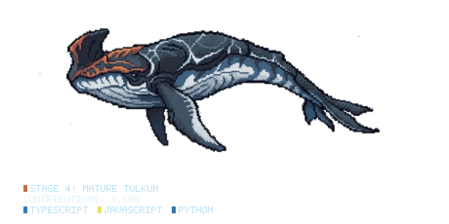

# dynamic-readme-creature

An open-source, browser-based studio for generating S-curve animated pixel creatures (Animated WebP and GIF) and customizable GitHub profile READMEs.

[](https://github.com/PathumSandeepa/dynamic-readme-creature)
[](https://pathumsandeepa.github.io/dynamic-readme-creature/)

> **This is an open source project. Contributions, issues and ideas are welcome.**

---

## Live Demo

Try the studio directly in your browser with no installation or backend account required:

- **Live Studio:** [pathumsandeepa.github.io/dynamic-readme-creature](https://pathumsandeepa.github.io/dynamic-readme-creature/)

<p align="center">
  <a href="https://pathumsandeepa.github.io/dynamic-readme-creature/">
    
  </a>
</p>

*(UI walkthrough screenshots will be added to `docs/screenshots/` once captured from a connected browser session.)*

---

## Features

- **Animated Pixel Creatures:** Choose between **Pixel Tulkun** (Side view and Top view) and **Pixel Jellyfish** (Pelagic view), animated via per-pixel S-curve kinematics.
- **Evolution Stages from Commits:** Creature scale (`0.46x` to `1.05x`) and bioluminescent wake density evolve across 5 stages (`Calf`, `Young`, `Sub-adult`, `Mature`, `Elder`) using either **Current Year** or **All Time** GitHub contributions.
- **Languages HUD & Palette Mapping:** Keep the original creature artwork or map `3`, `5`, or `7` editable programming language colors directly onto creature zones, with customizable HUD font (`Pixel`, `Mono`, `Sans`, `Serif`), weight, size, alignment, and custom label.
- **Water & Background Modes:** Switch between **In water** (animated glow, light rays, and bubbles), **No water** (subtle wake motes only), or **Clear** canvas, with **Transparent** or **Custom color** backgrounds.
- **Animated WebP, Animated GIF & Social Share Card:** Encode and download `creature.webp`, `creature.gif`, and a `1280x640` `share-card.png` directly in your browser.
- **Rich README Editor & Templates:** Write your profile intro in a live GitHub-width (`848px`) WYSIWYG markdown editor with 10 starter templates and dynamic tokens (`{{USERNAME}}`, `{{CREATURE}}`, `{{STAGE}}`, `{{RANK}}`, `{{COMMITS}}`, `{{VIEW}}`, `{{LANGUAGES}}`), plus a raw `README.md` override mode.
- **Multi-Card Tech Stack & CTA Links:** Group `202` built-in tech badges across 11 categories (or create custom badges) into reorderable, drag-and-drop cards, and add clickable CTA link badges with auto-detected platform icons.
- **12:00 AM Auto-Evolve GitHub Action:** Optionally generate `.github/workflows/evolve-creature.yml`, `scripts/evolve-creature.mjs`, and `creature-config.json` to regenerate `creature.webp` and update `README.md` markers every midnight.

---

## How It Works

1. **Connect:** Enter a GitHub username or profile URL to load public language weights, commit counts, and any existing `dynamic-readme-creature` configuration from `username/username`.
2. **Repository:** Verify (or follow the 3-step guide to create) your public `username/username` GitHub profile repository.
3. **Customize:** Configure your creature, colors, evolution source, HUD overlay, README intro, tech stack cards, CTA links, layout preset, and live GitHub Light/Dark preview.
4. **Publish:** Paste a temporary Classic (`ghp_...`) or Fine-grained (`github_pat_...`) Personal Access Token to push atomically to your profile repo, or download `creature.webp`, `creature.gif`, and `README.md` manually.

---

## Privacy and Security

- **100% Browser-Side Execution:** Profile lookups use read-only requests to the public GitHub REST API (plus public contribution calendar totals) directly from your browser.
- **In-Memory Tokens Only:** Personal Access Tokens entered on the Publish step stay strictly in React component memory for that tab. This static application never writes tokens to cookies, `localStorage`, `sessionStorage`, or any third-party server, and clears the token from memory immediately after a successful push.
- **Minimal Scopes:** Classic tokens require `repo` (plus `workflow` if installing the 12:00 AM GitHub Action). Fine-grained tokens scoped to `username/username` require `Contents: Read and write` (plus `Workflows: Read and write` if installing the 12:00 AM GitHub Action).

---

## Tech Stack

- **Framework:** Next.js `16.4.6` (App Router, static export via `output: "export"`), React `19.3.0`, TypeScript `5`
- **Styling & UI Primitives:** Tailwind CSS `4.3.3`, shadcn / `@base-ui/react`, `lucide-react`, `react-color-palette`
- **Rich Text & Markdown:** TipTap (`@tiptap/react`, `@tiptap/starter-kit`, `@tiptap/extension-table`, `@tiptap/extension-list`, `@tiptap/extension-image`, `@tiptap/extension-text-align`)
- **Media & Icons:** Browser Canvas + custom WebP RIFF/VP8L encoder, `gifenc` (GIF export), `simple-icons` (icon catalog generation), `sharp` (showcase & GitHub Action scripts)

---

## Getting Started

Prerequisites: **Node.js 22+** and **pnpm** (`pnpm@12.21.0`).

```bash
# 1. Clone the repository
git clone https://github.com/PathumSandeepa/dynamic-readme-creature.git
cd dynamic-readme-creature

# 2. Install dependencies
pnpm install

# 3. Start the local development server
pnpm dev
```

Open [http://localhost:3000](http://localhost:3000) in your browser.

### Available Scripts

```bash
# Run TypeScript typecheck and ESLint
pnpm exec tsc --noEmit
pnpm lint

# Build static production output into out/
pnpm build

# Start production server (for non-static testing)
pnpm start

# Build and publish out/ to GitHub Pages (gh-pages)
pnpm deploy
```

---

## Contributing

Contributions, bug reports, new creature sprites, and UI improvements are welcome:

1. Fork the repository and create a branch (`git checkout -b feat/your-change`).
2. Keep changes focused and preserve existing functionality.
3. Verify `pnpm exec tsc --noEmit`, `pnpm lint`, and `pnpm build` pass with zero errors.
4. Open a pull request describing your change (and include screenshots for UI changes) or open an issue to discuss ideas first.

---

## Credits

Created and maintained by [@PathumSandeepa](https://github.com/PathumSandeepa). Powered by Next.js, TipTap, Lucide Icons, `gifenc`, and Shields.io badges.
