# dynamic-readme-creature

A procedural, pure-CSS animated cybernetic creature generator for your GitHub profile `README.md` that evolves across **5 anatomical stages (`0 → 2,500+` contributions)**, supports **3 camera perspectives**, syncs with your **top GitHub programming languages**, and exports standalone `.svg` graphics with zero JavaScript required.

<p align="center">
  <a href="https://pathumsandeepa.github.io/dynamic-readme-creature/">
    
  </a>
</p>

<p align="center">
  <em>Live <code>dynamic-readme-creature</code> generated from <a href="https://github.com/PathumSandeepa">@PathumSandeepa</a>'s GitHub activity (Stage 4: Apex Cyber-Tulkun)</em>
</p>

---

## Quick Start (2-Step Setup)

1. Open the **[Interactive Creature Studio](https://pathumsandeepa.github.io/dynamic-readme-creature/)**, sync your GitHub username, customize your cybernetic creature & Profile `README.md`, and either click **Connect & Push** (with a fine-grained PAT held strictly in ephemeral browser memory with copy/cut disabled, under the [GitHub Privacy Statement](https://docs.github.com/en/site-policy/privacy-policies/github-general-privacy-statement)) or embed this block in your profile repo (`YOUR_USERNAME/YOUR_USERNAME`):

```html
<!-- CYBER-CREATURE:START -->
<p align="center">
  <a href="https://github.com/PathumSandeepa/dynamic-readme-creature">
    
  </a>
</p>
<!-- CYBER-CREATURE:END -->
```

> If your `README.md` includes `<!-- CYBER-CREATURE:START -->` and `<!-- CYBER-CREATURE:END -->`, the auto-evolve script automatically updates the live stage, commit count, top languages, and sync date between those markers every day at **12:00 AM**.

2. Create `.github/workflows/evolve-creature.yml` and `scripts/evolve-creature.mjs` (copyable from the Studio's **12AM Auto-Evolve** modal with your local timezone's 12:00 AM cron, or installed via **Connect & Push**):

```yaml
name: Evolve Cyber Creature

on:
  schedule:
    - cron: "0 0 * * *"
  workflow_dispatch:
  push:
    branches: [main]

permissions:
  contents: write

jobs:
  evolve:
    runs-on: ubuntu-latest
    steps:
      - uses: actions/checkout@v4
      - uses: actions/setup-node@v4
        with:
          node-version: "22"
      - name: Update Cyber Creature SVG
        env:
          GITHUB_TOKEN: ${{ secrets.GITHUB_TOKEN }}
          GITHUB_USERNAME: ${{ github.repository_owner }}
          CREATURE_WINDOW: "annual" # annual | rolling
          CREATURE_VIEW: "side"     # side | dive | top
        run: node scripts/evolve-creature.mjs
```

> **Try it in your browser or compare with a friend:** Open the **[Interactive Creature Studio & User Comparator](https://pathumsandeepa.github.io/dynamic-readme-creature/)** to sync any GitHub username, customize armor palettes, or export a `1280×640` social card instantly.

<p align="center">
  
  
  
  
  
</p>

---

## Share "Your Creature This Year" & Compare With Friends

Export a framed **`1280×640` social telemetry card (`share-card.svg`)** from the Studio showing your active evolution stage (`1.PRTO` → `5.ASCD`), contribution window (`ANNUAL` or `365D ROLLING`), commit count, and top 3 programming languages — ready to share on X, LinkedIn, or Discord:

<p align="center">
  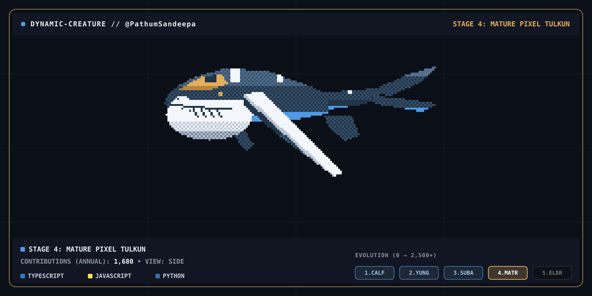
</p>

- **Dynamic Profile README.md Editor:** Customize your headline, bio, tech badges, alignment, telemetry stats table, and raw Markdown with live dynamic tokens (`{{STAGE}}`, `{{RANK}}`, `{{COMMITS}}`, `{{LANGUAGES}}`), then copy or download `README.md` directly.
- **Compare Developers Side-by-Side:** Enter any two GitHub usernames in the **Compare Users** tab to compare evolution stages, commit deltas, top languages, and animated cybernetic builds side-by-side.
- **Zero-JS GitHub Camo Compatibility:** All animations use pure CSS `@keyframes` inside `<svg><style>...</style></svg>`, ensuring smooth 60 FPS motion inside GitHub `README.md` image embeds.

---

## 3 Selectable Legless Cyber-Animals

| Chassis | Designation | Live Animated Preview | Architecture & Kinematics |
| --- | --- | :---: | --- |
| **Cyber-Tulkun**<br/>*Armored Leviathan* | `UNIT-01`<br/>`CETACEA-MK4` |  | Massive rounded whale-leviathan head with green HUD circuit decals, gyro-optic ear ring, segmented dorsal plates, 8 articulated wing feathers, and trailing fiber-optic cables. |
| **Cyber-Serpent**<br/>*Mecha Sky-Dragon* | `UNIT-02`<br/>`OROCHI-V7` |  | Sleek undulating S-curve robotic spine with optical visor helmet, spine-mounted dorsal feather crest, bold accented glider wings, and sweeping ribbon tail plumes. |
| **Cyber-Manta**<br/>*Aether Ray* | `UNIT-03`<br/>`MOBULA-X9` |  | Aerodynamic gliding ray with twin forward cephalic sensor prongs, illuminated gill turbine intakes, dorsal diamond core, wide feathered delta wings, and dual cyber-tendrils. |

---

## Evolution Stages (`0 → 2,500+` Contributions)

Your creature scales in wingspan and unlocks new mechanical hardware across **5 biological-mecha stages** (`annual` resets Jan 1st, or `rolling` tracks a trailing 365-day window):

| Stage | Contributions (`annual` or `rolling`) | Live Animated Preview | Anatomical Upgrades Unlocked |
| --- | :---: | :---: | --- |
| **Stage 1**<br/>Prototype | `0 – 149`<br/>contributions | 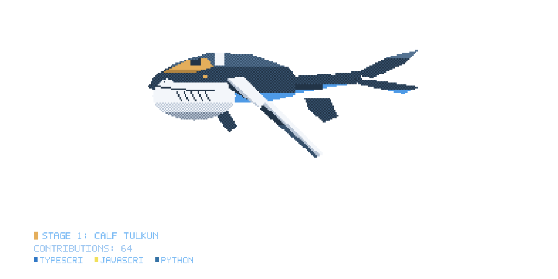 | Compact `0.72x` juvenile chassis, 4 starter pectoral wing feathers, minimal tail segments, blunt sensor dome, and 2 starter tail cables. |
| **Stage 2**<br/>Recon | `150 – 499`<br/>contributions | 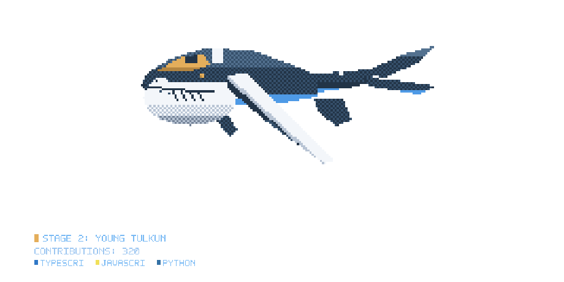 | Chassis expands to `0.81x`; cranial neural whips sprout behind the brow; active throat & flank energy conduits illuminate; 5 wing feathers and 4 tail cables. |
| **Stage 3**<br/>Armored | `500 – 1,199`<br/>contributions |  | Dorsal feather crest unfolds along the upper spine; secondary pelvic stabilizer paddles emerge; cranial HUD decals activate; 6 wing feathers and 6 tail cables. |
| **Stage 4**<br/>Apex | `1,200 – 2,499`<br/>contributions | 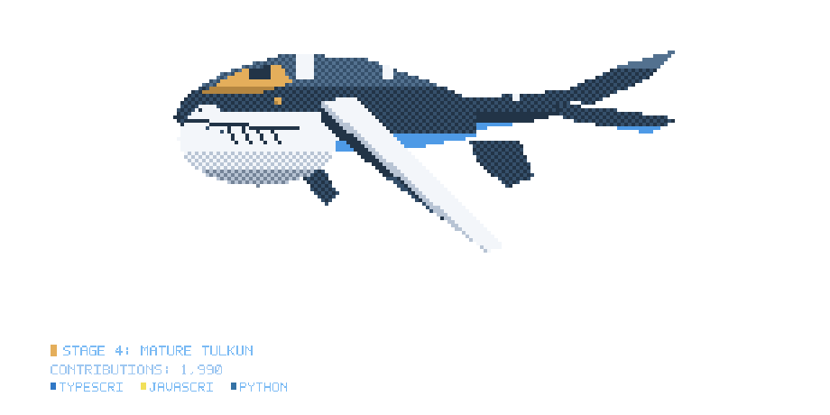 | Heavy segmented dorsal carapace armor, full multi-ring gyro-optic ear assembly, 8 articulated pectoral feathers with emitter filaments, and full 8-cable tail array. |
| **Stage 5**<br/>Ascended | `2,500+`<br/>contributions |  | Maximum `1.03x` leviathan span, overcharged crown crest plumes, glowing apex carapace energy scars, and dual-filament emitter tips. |

---

## Camera Perspectives (`view`)

Render your creature from **3 camera angles** (`side`, `dive`, or `top`):

| Camera Mode | Live Animated Preview | Description |
| --- | :---: | --- |
| `view: side`<br/>*(Default)* |  | **Lateral Side Glide:** Showcases modular head optics, layered dorsal carapace plates, sweeping pectoral wing-fins, and trailing fiber-optic tail array. |
| `view: dive` | 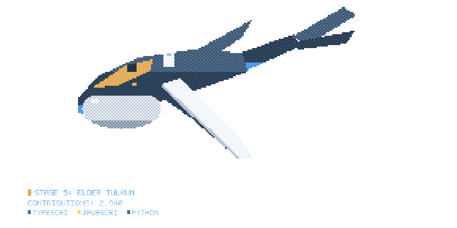 | **3/4 Dynamic Dive:** Pitched downward diving angle emphasizing kinetic glide trajectory and sweeping foreground wing feathers. |
| `view: top` |  | **Dorsal Top-Down:** Full symmetrical wingspan revealing dual feathered wings, vertebral spine plates, pelvic stabilizer paddles, and forked caudal tail flukes. |

---

## How the Rendering Engine Works

1. **Dynamic Language Color Ramps (`src/lib/themes.ts` & `src/lib/githubApi.ts`):**
   - Queries your public GitHub repositories via the REST API, ranks your **Top 3 programming languages** (such as TypeScript `#3178C6`, JavaScript `#F1E05A`, Python `#3572A5`, Rust `#DEA584`), and derives matching highlight, midtone, shadow, accent, and energy glow ramps — or choose **Canonical Mecha Presets** (*75% White / Orange / Green Default*, *Stealth Carbon / Cyan*, *Crimson Mecha*, *Solar Gold*) and full custom hex pickers.
2. **Modular Vector Kinematics & Pure CSS `@keyframes` (`src/lib/creatureArt.ts`):**
   - Every feather, ribbed conduit, fiber-optic cable, and wing joint is rendered from parameterized Bezier paths and grouped under staggered CSS animations (`.cc-float`, `.cc-wing-near`, `.cc-wing-far`, `.cc-f1`–`.cc-f6`, `.cc-c1`–`.cc-c5`, `.cc-pulse`) with duration scaled dynamically by your speed multiplier (`0.5x` – `2.5x`).
3. **2-Row Bottom HUD Telemetry & `1280×640` Share Card (`src/lib/generateShareCardSvg.ts`):**
   - Displays your current evolution stage, custom title, formatted commit count, camera angle, speed multiplier, top 3 language swatches, and the `1.PRTO → 5.ASCD` stage progression rail cleanly inside the SVG.

---

## Auto-Evolve Script Environment Options

| Variable | Default | Description |
| --- | --- | --- |
| `GITHUB_USERNAME` | `github.repository_owner` | GitHub username whose contributions are queried via GraphQL. |
| `CREATURE_WINDOW` | `"annual"` | Contribution window: `annual` (resets Jan 1st) or `rolling` (trailing 365 days). |
| `CREATURE_VIEW` | `"side"` | Camera perspective metadata: `side`, `dive`, or `top`. |
| `GITHUB_TOKEN` | `${{ secrets.GITHUB_TOKEN }}` | GitHub Actions token used to query contributions and push to the orphan `output` branch. |

---

## Local Development & Static Export

```bash
# 1. Install dependencies
pnpm install

# 2. Start local dev server (http://localhost:3000)
pnpm dev

# 3. Regenerate static README showcase SVGs
node scripts/generate-showcase.mjs

# 4. Build static export into ./out
pnpm build
```

---

## Deploying to GitHub Pages

This project is preconfigured for zero-config GitHub Pages static hosting:

- [next.config.ts](next.config.ts) sets `output: "export"`, `images: { unoptimized: true }`, and dynamically sets `basePath` and `assetPrefix` from `GITHUB_REPOSITORY` (`""` locally, `/<repo-name>` in GitHub Actions).
- [.github/workflows/deploy.yml](.github/workflows/deploy.yml) builds `./out` and deploys automatically on every push to `main`.

To enable GitHub Pages:
1. Push this repository to `main` on GitHub.
2. Open **Settings → Pages** in your repository.
3. Under **Build and deployment**, set **Source** to **GitHub Actions**.

---

## License

MIT © [PathumSandeepa](https://github.com/PathumSandeepa)
