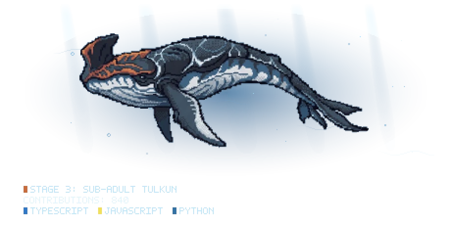

# dynamic-readme-creature

A sprite-based, **S-curve animated marine creature** and full **GitHub Profile README Studio** that evolves automatically with your GitHub contributions (`0 → 2,500+`), exports smooth **Animated WebP** and **Animated GIF** graphics, syncs **3, 5, or 7 programming language colors** directly onto your creature, and stays fresh at **12:00 AM** every day.

<p align="center">
  <a href="https://pathumsandeepa.github.io/dynamic-readme-creature/">
    
  </a>
</p>

<p align="center">
  <a href="https://pathumsandeepa.github.io/dynamic-readme-creature/">
    
  </a>
  
  
  
  
</p>

---

## Features

- **Real S-Curve Pixel Animation (WebP & GIF):** Smooth per-pixel spine undulation, pectoral fin sweeps, and anatomical jellyfish bell contractions rendered directly to `creature.webp` and `creature.gif` (no CSS animation dependencies).
- **In Water or Clean Canvas:** Switch between an animated underwater ocean backdrop (light rays, drifting currents, rising pixel bubbles) or a clean transparent / custom-colored canvas.
- **3, 5, or 7 Customizable Language Colors:** Choose `3`, `5`, or `7` top languages in the pixel HUD, customize any language color with the integrated color palette, and watch the colors reflect live onto your creature — or switch back to **Original Colors** anytime.
- **Multi-Card Drag & Drop Tech Stack Builder:** Starts with 3 organized tech cards and **202+ verified skills & badges** across 11 categories, with one-click **Combine All** and single-click **Undo Combine**.
- **Full Profile README Builder & Direct Push:** Customize your intro paragraph, role tags, CTA links, layout alignment, banner width, social share card, and optional **12:00 AM daily GitHub Action**.

---

## Selectable Pixel Creatures

| Creature | View Angles | Live Preview | Motion & Kinematics |
| --- | :---: | :---: | --- |
| **Pixel Tulkun**<br/>*Armored Leviathan* | `Side View` &amp; `Top View` |  | Continuous S-curve body swimming, rowing pectoral fins, and forked tail propulsion across both lateral and dorsal perspectives. |
| **Pixel Jellyfish**<br/>*Bioluminescent Medusa* | Pelagic View |  | Asymmetric pulsing bell dome, forward jet-propulsion surge, and fluid S-curve undulating oral arms and filaments. |

---

## Tulkun Camera Perspectives (`side` & `top`)

| Perspective | Live Preview | Description |
| --- | :---: | --- |
| **Side View** |  | Lateral S-curve swim highlighting the copper brow crest, pleated jaw, pectoral stroke, and tail wave. |
| **Top View** |  | Dorsal S-curve swim highlighting full symmetrical wingspan and glowing dorsal patterns. |

---

## Evolution Stages (`0 → 2,500+` Contributions)

| Stage | Contributions | Live Preview | Upgrades |
| --- | :---: | :---: | --- |
| **Stage 1 — Calf** | `0 – 149` |  | Compact `0.74x` scale with smooth baseline S-curve glide. |
| **Stage 2 — Young** | `150 – 499` |  | `0.82x` scale with starter bioluminescent wake motes. |
| **Stage 3 — Sub-Adult** | `500 – 1,199` |  | `0.90x` span with richer ambient wake stream. |
| **Stage 4 — Mature** | `1,200 – 2,499` |  | `0.98x` mature span with dense glowing particle trail. |
| **Stage 5 — Elder** | `2,500+` |  | Maximum `1.05x` span and overcharged wake stream. |

---

## Social Share Card (`1280×640`)

<p align="center">
  
</p>

---

## Clone & Contribute (Improve This Project)

Contributions, new pixel creatures, animation refinements, and UI improvements are always welcome!

### 1. Clone the repository

```bash
git clone https://github.com/PathumSandeepa/dynamic-readme-creature.git
cd dynamic-readme-creature
```

### 2. Install dependencies & start locally

> Uses **Node.js 22+** and **pnpm** (`corepack enable` if `pnpm` is not already installed).

```bash
pnpm install
pnpm dev
```

Open [http://localhost:3000](http://localhost:3000) to test changes live in your browser.

### 3. Project Structure

```text
src/
├── domain/
│   ├── creature/       # Creature entities, S-curve RGBA animation engine, palette mapping
│   ├── profile/        # Tech stack catalog (200+ items), multi-card stack & README builder
│   └── automation/     # 12:00 AM GitHub Action & standalone WebP evolution script generator
├── application/        # Studio state controller (useStudioController.ts)
├── infrastructure/     # Browser WebP/GIF encoders, sprite loader & GitHub API client
└── presentation/       # Next.js studio UI components & react-color-palette pickers
scripts/
├── extract-sprites.mjs # Extracts transparent RGBA sprites from assets/source/
└── generate-showcase.mjs # Generates animated WebP & share-card assets in public/showcase/
```

### 4. Verify before opening a Pull Request

```bash
# Optional: re-extract sprites or regenerate README showcase WebP files
node scripts/extract-sprites.mjs
node scripts/generate-showcase.mjs

# Typecheck, lint, and verify static GitHub Pages build
pnpm exec tsc --noEmit
pnpm lint
pnpm build
```

1. Fork the repository and create a feature branch (`git checkout -b feat/your-improvement`).
2. Commit your changes and push to your fork.
3. Open a Pull Request against `main` with screenshots or sample output if modifying animations or UI.

---

## License

MIT © [PathumSandeepa](https://github.com/PathumSandeepa)
